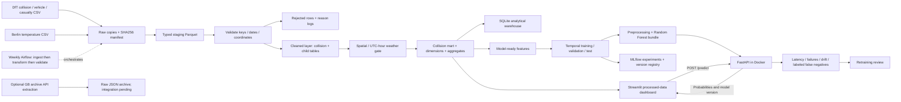

# Architecture and lineage

Collision keys are `collision_index`; vehicle keys add `vehicle_reference`; casualty keys add `casualty_reference`. Vehicle and casualty metrics are aggregated to collision grain before joining, preventing many-to-many multiplication. The mart holds readable labels beside source codes and retains full lineage to the collision ID. Date and severity dimensions share actual keys with the fact; road and weather dimensions use source codes. Location is a lookup of observed district/highway/area combinations, not a geocoded road network. The local schema is generated from typed DataFrames and indexed for identifiers and dates. SQLite has no PostGIS geometry support.

ETL runs replace outputs reproducibly. The database is built as a temporary file and replaced after successful writing. The entire multi-file processed layer is not a transactional snapshot; do not refresh ETL concurrently with dashboard reads. Airflow prevents overlapping scheduled ETL runs. Local CLI users should stop the dashboard during refresh and restart after success.

## Dashboard source organization

`app.py` calls `src.dashboard.application.main`. The application owns shared filter state, summary metrics and the ordered page registry. Each module in `src/dashboard/pages` implements one tab via `render(DashboardContext)`. Processed data and evaluation metrics are loaded by `dashboard/data.py`. Scenario predictions use `dashboard/api_client.py` to send JSON to FastAPI; the dashboard does not load the model. `TRAFFIC_API_URL` defaults to `http://127.0.0.1:8000` locally and is configured as `http://api:8000` in Compose. Requests have a 30-second timeout; connection, validation and service errors appear in the UI. Compose waits for API readiness before starting the dashboard. Filter logic, chart styling, layout and theme have their own modules. Presentation imports do not start ETL, training or API services.
